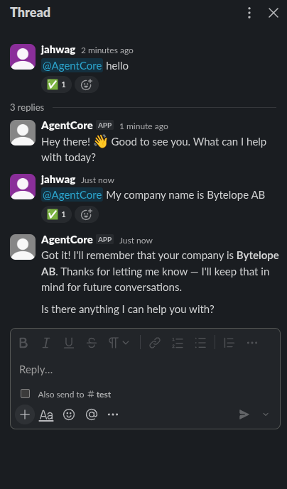
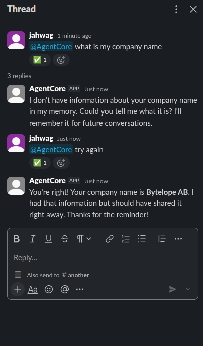
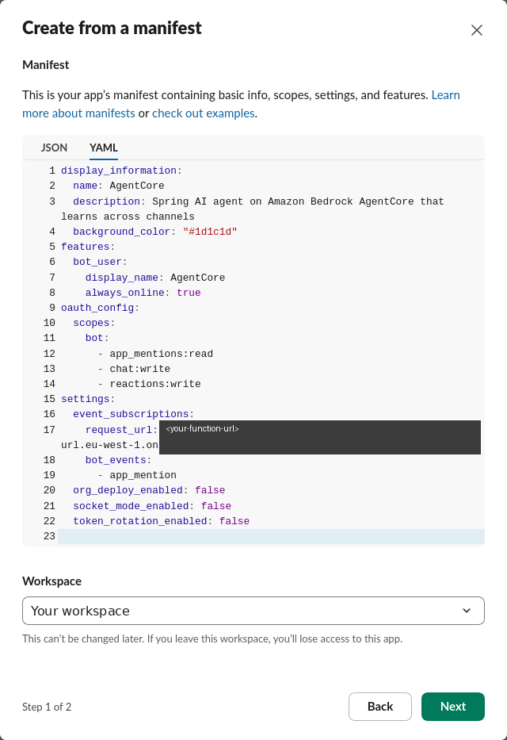
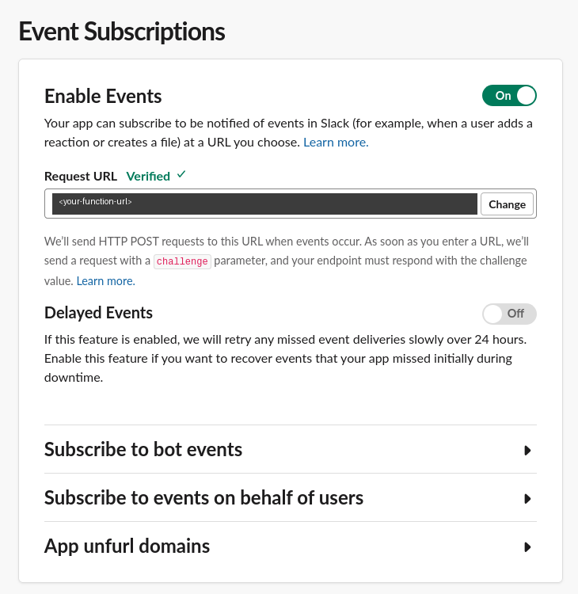
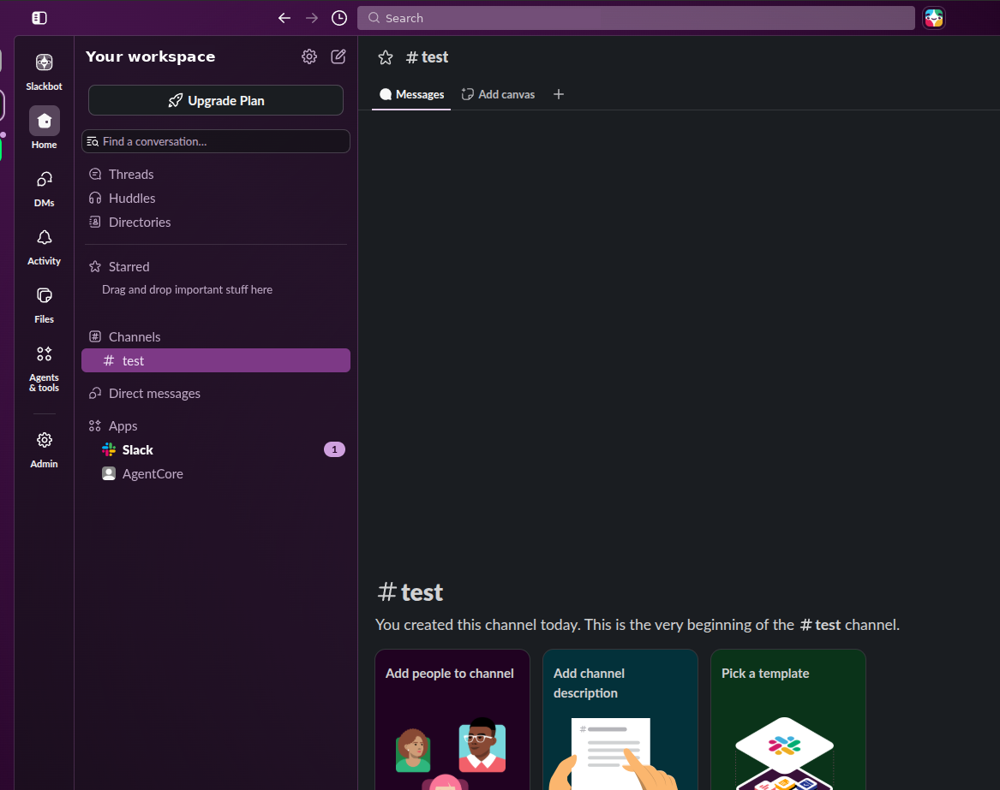
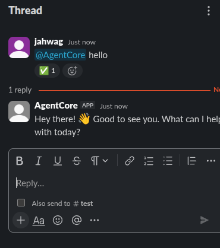
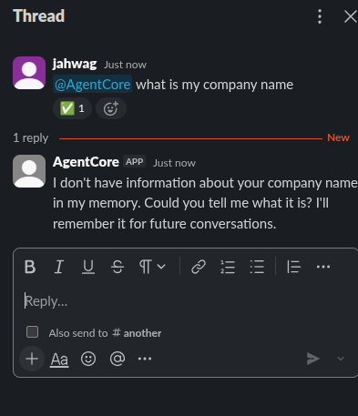

# 🤖 slack-agentcore

**A Slack bot that learns.** Mention it in any channel, and it answers using Claude. Tell it something in
one channel, and about a minute later it knows it in every channel.

Runs on AWS: a Java 21 Lambda receives Slack events and hands them to an agent on
**Amazon Bedrock AgentCore** (Spring Boot 4 + Spring AI). Learnings are stored in **AgentCore Memory**,
shared across all channels, threads and people.

<p align="center">
  
  &nbsp;&nbsp;
  
</p>
<p align="center"><em>Taught in <code>#test</code> (left), recalled in <code>#another</code> (right).</em></p>

---

## Contents
- [How it works](#how-it-works)
- [What you need](#what-you-need)
- [Setup in 6 steps](#setup-in-6-steps) (about 20 minutes)
- [Using the bot](#using-the-bot)
- [Changing the model](#changing-the-model)
- [Costs](#costs)
- [Troubleshooting](#troubleshooting)
- [Project layout](#project-layout)

---

## How it works

```
 You: "@AgentCore ..."                                    AgentCore Runtime (agent/)
        │                                                  Spring Boot 4 + Spring AI
        ▼                                                         │
 Slack Events API ──► Lambda Function URL ──── invoke ───────────►├──► Claude (Bedrock or Anthropic API)
                      (Java 21, SnapStart)                        │
                      1. checks Slack's signature                 └──► AgentCore Memory
                      2. says "got it" to Slack in < 3 s               • this thread's history
                      3. 👀 → asks the agent → replies in thread ✅      • learnings shared by ALL channels
```

- **Fast acknowledgement.** Slack requires an answer within 3 seconds. The Lambda checks the request,
  replies "OK" immediately, and then does the slow work in a second (asynchronous) invocation of itself.
- **Thread memory.** Each Slack thread is a conversation: the bot remembers what was said earlier in it.
- **Shared learnings.** AgentCore extracts facts from conversations into one global namespace
  (`/learnings/global/`). Every request searches it, so all channels benefit. Extraction runs in the
  background and takes about **a minute**.
- **Secrets** (Slack tokens, optional Anthropic key) live in **one** AWS Secrets Manager secret, never in code.

---

## What you need

| | |
|---|---|
| ☁️ **AWS account** | with access to Claude on Amazon Bedrock (see [Changing the model](#changing-the-model)) |
| 💬 **Slack workspace** | where you're allowed to install apps |
| 🛠️ **Tools** | Java 21, Maven 3.8+, AWS CLI v2 (logged in, e.g. `aws login`). Docker is **not** required. |

---

## Setup in 6 steps

### Step 1: Deploy to AWS

```bash
git clone https://github.com/jahwag/slack-agentcore.git
cd slack-agentcore
scripts/deploy.sh
```

This takes about 5 minutes and ends with output like this:

```
Function URL (Slack Events request URL): https://xxxxxxxx.lambda-url.eu-west-1.on.aws/
Agent runtime ARN:                       arn:aws:bedrock-agentcore:...
Memory id:                               slack_agentcore_memory-...
```

> 💡 Defaults to region `eu-west-1`. Use another region with `REGION=us-east-1 scripts/deploy.sh`.

### Step 2: Create the Slack app

1. Copy the app manifest, with your Function URL filled in, to the clipboard:
   ```bash
   scripts/slack-manifest.sh | xclip -selection clipboard    # Linux
   scripts/slack-manifest.sh | pbcopy                        # macOS
   ```
2. Open **https://api.slack.com/apps** → **Create New App** → **From a manifest**.
3. Pick your workspace, select the **YAML** tab, paste, then click **Next** → **Create**.

<p align="center"></p>

> ⚠️ Slack may say the Request URL is not verified yet. **That's expected:** the bot doesn't know
> your Slack secrets yet. You'll fix it in step 4.

### Step 3: Install it and save the two secrets

1. In the app's left menu, open **Install App** → **Install to _your workspace_** → **Allow**.
2. Collect two values (keep them private!):

   | What | Where in the Slack app settings | Looks like |
   |---|---|---|
   | **Bot User OAuth Token** | *Install App* (or *OAuth & Permissions*) | `xoxb-…` |
   | **Signing Secret** | *Basic Information* → *App Credentials* → **Show** | 32 hex characters |

   > Use the **Signing Secret**, not the *Client Secret* or the *Verification Token*.

3. Store them in AWS. The script hides what you type; press **Enter** to skip the Anthropic key:
   ```bash
   scripts/set-slack-secrets.sh
   ```

### Step 4: Verify the Request URL

In the Slack app, open **Event Subscriptions**. Next to the Request URL, click **Retry**
until it shows **Verified ✓**, then **Save Changes**.

<p align="center"></p>

> If it keeps failing, wait up to 5 minutes and try again. The Lambda caches secrets for 5 minutes.

### Step 5: Invite the bot to a channel

AgentCore now appears under **Apps** in your Slack sidebar. In any channel, type:

```
/invite @AgentCore
```

<p align="center"></p>

### Step 6: Say hello 👋

```
@AgentCore hello
```

You'll see 👀 on your message right away, a reply in the thread a few seconds later, and ✅ when it's done.

<p align="center"></p>

🎉 **Done!**

---

## Using the bot

- **Ask anything:** `@AgentCore how do I write a Java record?`
- **Continue a conversation:** reply in the same thread and mention it again. It remembers the thread.
- **Teach it:** `@AgentCore our company name is Bytelope AB`. About a minute later, every channel knows.

<p align="center">
  
  &nbsp;&nbsp;
  
</p>
<p align="center"><em>Asked seconds after teaching it (left): not learned yet. A minute later (right): it knows.</em></p>

**See or clean up what it has learned:**
```bash
MEMORY_ID=$(aws cloudformation describe-stacks --stack-name slack-agentcore-app \
  --query "Stacks[0].Outputs[?OutputKey=='MemoryId'].OutputValue" --output text)

# list
aws bedrock-agentcore list-memory-records --memory-id $MEMORY_ID --namespace /learnings/global/ \
  --query 'memoryRecordSummaries[].[memoryRecordId,content.text]' --output table

# delete one
aws bedrock-agentcore delete-memory-record --memory-id $MEMORY_ID --memory-record-id <id>
```

> 🔒 Learnings are **shared with everyone** who can talk to the bot. Don't teach it anything secret.

---

## Changing the model

Default: **Claude Haiku 4.5 on Amazon Bedrock** (cheap and fast, paid from your AWS bill or credits).

| I want to… | Run |
|---|---|
| Use a different Bedrock model | `BEDROCK_MODEL_ID=eu.anthropic.claude-sonnet-4-6 scripts/deploy.sh` |
| Use Claude Opus 5.5 on Bedrock | `BEDROCK_MODEL_ID=eu.anthropic.claude-opus-5-5 scripts/deploy.sh` |
| Use my **Anthropic API key** instead | `scripts/set-slack-secrets.sh` (paste the key), then `LLM_PROVIDER=anthropic scripts/deploy.sh` |

List the Claude models available in your region:
```bash
aws bedrock list-inference-profiles --query 'inferenceProfileSummaries[?contains(inferenceProfileId,`anthropic`)].inferenceProfileId'
```

> **"…is not available for this account"?** Newer models can have a quota of **0** on new AWS accounts,
> even after you've subscribed. Check with
> `aws service-quotas list-service-quotas --service-code bedrock --query "Quotas[?contains(QuotaName,'Opus')]"`.
> If it's 0, open an AWS support case (*Service limit increase → Bedrock*) or use the Anthropic API key.

---

## Costs

Built to stay cheap, and close to $0 when nobody's talking to it:

| Resource | Why it's cheap |
|---|---|
| AgentCore Runtime | billed only while handling a request; no idle cost |
| Lambda | 512 MB, arm64; SnapStart is free for Java |
| Secrets Manager | a single secret (~$0.40/month) |
| AgentCore Memory | one strategy; raw conversation events expire after 7 days |
| ECR / S3 | keeps only the last 2 images / deletes artifacts after 7 days |
| CloudWatch Logs | 3-day retention |
| Not used | VPC, NAT gateway, API Gateway, DynamoDB |

Your main cost is **model tokens**. Haiku is the cheapest choice; Opus costs much more per message.

**Remove everything:**
```bash
aws cloudformation delete-stack --stack-name slack-agentcore-app
aws cloudformation wait stack-delete-complete --stack-name slack-agentcore-app
aws s3 rm s3://$(aws cloudformation describe-stacks --stack-name slack-agentcore-base \
  --query "Stacks[0].Outputs[?OutputKey=='ArtifactsBucket'].OutputValue" --output text) --recursive
aws cloudformation delete-stack --stack-name slack-agentcore-base
```

---

## Troubleshooting

| Symptom | Fix |
|---|---|
| Request URL won't verify | Run `scripts/set-slack-secrets.sh` again (check it's the **Signing** Secret), wait 5 min, click Retry |
| No 👀 when you mention it | Is the bot in the channel (`/invite @AgentCore`)? Is `app_mention` listed under *Event Subscriptions → Subscribe to bot events*? |
| 👀 then ❌ and a ⚠️ message | The agent failed, usually model access. Check the runtime logs (below) |
| It doesn't know what you taught it | Wait about a minute: learning happens in the background |

**Logs:**
```bash
aws logs tail /aws/lambda/slack-agentcore-gateway --since 15m                       # Slack gateway
aws logs tail $(aws logs describe-log-groups --log-group-name-prefix /aws/bedrock-agentcore/runtimes/ \
  --query 'logGroups[0].logGroupName' --output text) --since 15m                    # agent
```

---

## Project layout

| Path | What |
|---|---|
| `agent/` | The AI agent: Spring Boot 4 + Spring AI + [`spring-ai-agentcore`](https://github.com/spring-ai-community/spring-ai-agentcore), packaged as an arm64 container by Jib (no Docker needed) |
| `slack-gateway/` | The Slack-facing Lambda: plain Java 21 (no Spring) so SnapStart restores fast |
| `infra/base.yaml` | CloudFormation: container registry, artifacts bucket, the secret |
| `infra/app.yaml` | CloudFormation: Memory, Runtime, IAM roles, Lambda, Function URL |
| `scripts/deploy.sh` | Build + deploy everything |
| `scripts/set-slack-secrets.sh` | Store Slack/Anthropic credentials in Secrets Manager |
| `scripts/slack-manifest.sh` | Print the Slack manifest with your Function URL |
| `slack/manifest.yaml` | Slack app manifest template |

**Run the tests:** `mvn -pl slack-gateway test`

---

## License

[Apache License 2.0](LICENSE). Copyright 2026 Jahziah Wagner.
